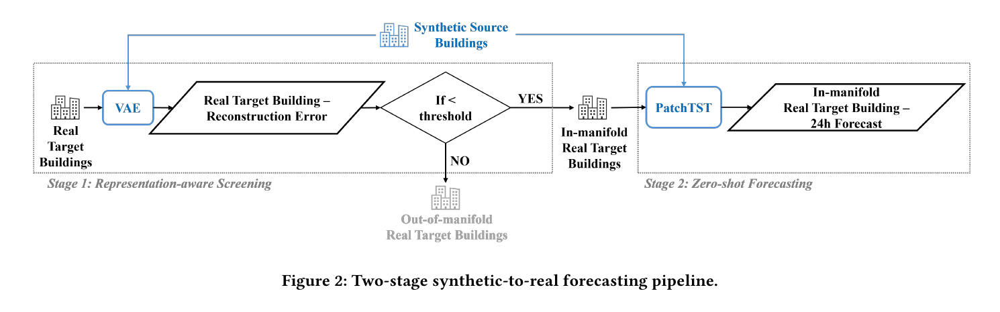

# STARS: Synthetic-to-real building energy forecasting

Research code supporting **STARS (Synthetic-to-real Transfer for At-scale Robust Short-term forecasting)**, a two-stage pipeline for portfolio-scale, day-ahead building electricity forecasting:

1. a variational autoencoder (VAE) screens real buildings for compatibility with the synthetic source domain; and
2. a PatchTST model pretrained on synthetic ComStock profiles produces 24-hour zero-shot forecasts for the retained buildings.

The current study uses New York subsets of ComStock as the synthetic source domain and Building Data Genome Project 2 (BDG2) as the real target domain.

For a compact description of the model configuration and evaluation design, see [`docs/methodology.md`](docs/methodology.md).

## Summary of the work

Large-scale building energy forecasting is often limited by the lack of long, high-quality meter histories for individual buildings. STARS addresses this problem by transferring knowledge from a large synthetic building stock to real buildings without retraining a separate forecasting model for every target.

The workflow has two stages:

1. **Representation-aware screening.** A lightweight VAE is trained on calendar-aligned, 14-day electricity-load windows from 8,856 New York ComStock simulations. Reconstruction error is then used to identify real buildings whose load behavior is sufficiently represented by the synthetic source domain.
2. **Zero-shot forecasting.** A PatchTST model pretrained on the same synthetic portfolio uses the preceding 336 hours of electricity, weather, and calendar features to forecast the next 24 hours for buildings that pass the VAE screen. No target-building fine-tuning is required.



*The VAE screens real targets for synthetic-domain compatibility before the pretrained PatchTST issues a 24-hour forecast.*

The published evaluation uses 101 New York buildings from BDG2. The VAE-screened pipeline reports a mean CVRMSE of **12.07% for 83 summer targets (82.2% coverage)** and **11.44% for 85 winter targets (84.2% coverage)**. These results show that synthetic pretraining combined with applicability screening can support accurate portfolio-scale forecasts while reducing the risk of negative transfer.

## Data availability

**Datasets are intentionally not included in this repository.** Both source datasets are publicly available, but the processed corpus is too large for GitHub and should be downloaded from its original provider. See [`data/README.md`](data/README.md) for sources, expected local paths, and the files produced by preprocessing.

The `.gitignore` blocks raw data, processed data, model weights, checkpoints, and generated experiment artifacts. Before every push, run `git status --short` and verify that no data or credentials are staged.

## Repository layout

```text
STARS-public/
├── data/                 # instructions only; local data are ignored
├── docs/                 # methodology and release notes
├── notebooks/            # ordered research workflow
├── results/              # compact manuscript-level summary only
├── src/                  # minimal PatchTST dependencies used by notebooks
├── .gitattributes
├── .gitignore
├── CITATION.cff
├── README.md
├── THIRD_PARTY_NOTICES.md
└── requirements.txt
```

## Notebook workflow

The notebooks are ordered by their role in the study:

| Notebook | Purpose |
|---|---|
| `01_download_comstock.ipynb` | Download the public ComStock source files from NREL's public S3 bucket. |
| `02_prepare_source_data.ipynb` | Combine prepared per-building source files into the modeling table. |
| `03_vae_screening_summer.ipynb` | Train/evaluate the summer VAE and screen real targets. |
| `04_vae_screening_winter.ipynb` | Train/evaluate the winter VAE and screen real targets. |
| `05_patchtst_summer.ipynb` | Train the full-source summer PatchTST baseline and evaluate targets. |
| `06_patchtst_winter.ipynb` | Train the full-source winter PatchTST baseline and evaluate targets. |
| `07_knn_ablation.ipynb` | Run similarity-based source-selection ablations. |

Notebook outputs and execution counters have been cleared for publication. Large generated outputs belong under `data/` or `results/` and remain untracked.

## Installation

Python 3.10 or 3.11 is recommended. Create an isolated environment, install PyTorch using the command appropriate for your CPU/GPU platform, and then install the remaining dependencies:

```bash
python -m venv .venv
# Windows: .venv\Scripts\activate
# macOS/Linux: source .venv/bin/activate
python -m pip install --upgrade pip
python -m pip install -r requirements.txt
```

Launch Jupyter from this repository root so that the relative paths in the notebooks resolve consistently:

```bash
jupyter lab
```

## Reported results

`results/metrics_summary.csv` transcribes the seasonal comparison reported in Table 4 of the manuscript. It is included as a compact reference, not as a substitute for rerunning the experiments. The manuscript metrics should be reconciled against a single frozen experiment export before a tagged release.

## Publication and citation

This repository accompanies the following BuildSys 2025 paper:

> Heng Quan and Semiha Ergan. 2025. **Sim-to-Real Transfer Learning for Large-Scale Short-Term Building Energy Forecasting in Sustainable Cities.** In *Proceedings of the 12th ACM International Conference on Systems for Energy-Efficient Buildings, Cities, and Transportation (BuildSys '25)*. Association for Computing Machinery, New York, NY, USA, 86–95. https://doi.org/10.1145/3736425.3772006

```bibtex
@inproceedings{quan2025stars,
  author    = {Heng Quan and Semiha Ergan},
  title     = {Sim-to-Real Transfer Learning for Large-Scale Short-Term Building Energy Forecasting in Sustainable Cities},
  booktitle = {Proceedings of the 12th ACM International Conference on Systems for Energy-Efficient Buildings, Cities, and Transportation},
  series    = {BuildSys '25},
  year      = {2025},
  pages     = {86--95},
  publisher = {Association for Computing Machinery},
  address   = {New York, NY, USA},
  doi       = {10.1145/3736425.3772006},
  url       = {https://doi.org/10.1145/3736425.3772006}
}
```

GitHub also reads the repository's [`CITATION.cff`](CITATION.cff) file and can generate citation formats automatically.
